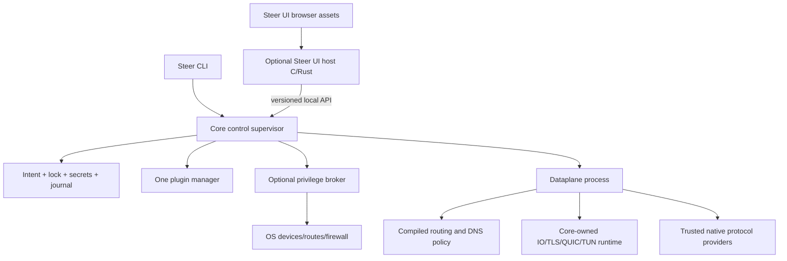

# Steer 3.0.0: состав системы, миграция и план исполнения

Статус: план реализации. Решения дополняют [основную архитектуру](universal-core.md),
не являются заявлением о готовом релизе. Linux server — первая целевая поставка;
универсальность архитектуры не означает одновременную готовность всех ОС.

## 1. Что означает версия 3.0.0

Первый выпуск 3.0.0 допускается после Linux gates A–E ниже: работающий core без
UI, единый shared runtime, новая plugin boundary, inbound/outbound текущих
протокольных семейств по объявленной матрице, реальная панель и проверенная
миграция Linux-установок. Непроверенная комбинация протокола не рекламируется.
OpenWrt cutover — отдельный gate F; до него существующая 2.x поставка остаётся
поддерживаемой. Windows/Android и feasibility iOS — gate G и не блокируют Linux
3.0.0. Это порядок поставок, а не разрешение ломать платформенные контракты.

Версия 3.0.0 core не автоматически означает SDK 3.0 или provider API 3.0:
оси версий независимы. RC не становится stable из-за готовности интерфейса.

### Что входит и что исключено

- Входит: server/client/gateway в общей модели, shared networking runtime,
  v1/v2 compatibility, v3 intent + lock, SDK, protocol/feature plugins C/Rust,
  Steer UI, upstream compatibility lab и resource gates.
- Все настоящие протоколы получают server/client направления, где протокол
  их определяет. Feature/service integration (WARP registration, subscriptions)
  не превращается в выдуманный self-hosted протокол. WG — symmetric device peer.
- Mieru не реализуется. Пример внешнего provider не создаёт задачу его портирования.
- Нет обязательных Kubernetes, облачной control plane, Redis, SQL-сервера,
  Node/Go runtime, Electron или процесса на каждого пользователя/протокол.
- Cluster/multi-node orchestration, billing и HA consensus не входят в 3.0.0.
  UI управляет одним ядром; API не закрывает возможность внешней оркестрации.

## 2. Состав поставки и процессы

Core daemon — control/supervision, не web server. Dataplane отдельным процессом
на Linux/OpenWrt позволяет UI/CLI восстановить routing после падения provider.
Это одна граница на dataplane, не per-flow IPC. На mobile library embedding
supervision выполняет platform host, process split не навязывается расширению.
Management plugin работает от непривилегированного пользователя. Core broker
имеет allowlisted typed operations; UI не получает shell/root session.

Первый Linux proxy-only profile не требует root, nftables или TUN. Privileged
capture/WG отдельно запрашивает capability и явную конфигурацию. Linux adapters:
epoll/timerfd/eventfd, sockets, netlink, service integration systemd с ручным
foreground запуском для теста. OpenWrt adapter: musl, procd, ubus/netifd bridge,
firewall ownership и sysupgrade. OpenWrt UI не требует LuCI/rpcd как обязательного
host; переходный LuCI launcher может открывать тот же UI через adapter.

Core package содержит CLI/control/dataplane и только выбранные core runtime
libraries. TLS/QUIC/TUN build features исключаются, если профиль ими не пользуется.
Provider packages и optional UI ставятся существующим manager. `steer_main` и
`steer_extended` — aliases/meta bundles: resolution раскрывает concrete packages,
providers и зависимости. До реализации meta bundle разрешён прямой alias
отдельного пакета; фиктивный `steer-main` не публикуется как готовая поставка.
Rust компоненты используют тот же C ABI; Rust toolchain нужен при сборке, не
на целевом устройстве. Browser TypeScript допустим как build source, plugin host
и server-side logic остаются C/Rust.

Config/secrets/journal размещаются через platform paths API. Linux defaults:
`/etc/steer` intent/trust/config, `/var/lib/steer` durable state/packages,
`/run/steer` sockets/ephemeral data. Это новая layout policy, не молчаливый перенос
существующих plugins paths. OpenWrt сохраняет текущие пути до отдельного migration
plan. Core CLI показывает effective paths. Relative files считаются от файла
intent, не от cwd сервиса; stdin требует явно определённого base directory.

## 3. Реальные точки изменений в существующем коде

| Исходная область | Изменение | Что нельзя потерять |
|---|---|---|
| `src/model/parse.c`, `v1.c`, `v2.c` | Добавить v3 parser/normalizer рядом | Старые formats/errors, strict v2, дубликаты YAML/JSON |
| `src/model/spec.h` | Ввести отдельную portable flow IR и adapter legacy model | Текущая модель связана с nft/marks; rename недостаточен |
| `src/compile/generate.c` | Оставить Linux policy backend; общий policy compiler отделить | Guards, IPv6, fake-IP, fail-closed, ingress semantics |
| `src/daemon/apply.c` | Generation prepare/commit/journal orchestration | Реальные side effects и rollback, current apply compatibility |
| `src/daemon/recon.c` | Reconcile intent/active/resources с generation ID | Kernel drift и частичное применение |
| `src/daemon/supd.c` | Native provider host + legacy helper adapter | hello/API/id, orphan cleanup, events и DNS adoption |
| `src/daemon/loop.*` | Portable loop interface, Linux backend сохранить | Deferred event deletion, explicit fd ownership |
| `src/dnsd/tabfmt.c`, `adopt.*` | Versioned policy snapshot и generation adoption | DNS не перечитывает spec, resolver continuity |
| `src/net1/s2pnet.h`, `build/net1/libs2p-net.map` | Core runtime ownership + новый opaque ABI | Старый fingerprint/exports/SONAME/RUNPATH |
| `src/tunnel/stack.*`, `dialer.h`, `pool.c` | Per-instance state, lifecycle/cancel, host services | TLS/global state, detached threads, readiness/flow lifetime |
| `src/proto/*`, `plugins/*` | По одному provider переносить в новый repo | История, license notices, codecs и package IDs |
| `src/proto/xsteer/xshub.c`, `src/proto/obfs/obfs.c` | Адаптировать существующие server modes | Они уже существуют; не переписывать wire вслепую |

Первый blocking audit перед shared-process runtime: устранить process-global
и `__thread` конфигурацию, detached ownership и предположения «один dialer на
процесс» в stack/pool. До прохождения multi-instance stress старые реализации
остаются legacy helpers. Перенос файла в core не делает его reentrant.

**Полный сетевой стек — отдельная работа.** В текущем `stack_run_fd` host-TUN
переносит UDP, TCP сбрасывается: OpenWrt TCP опирается на Linux NAT tcp-redir.
Поэтому Android VpnService сейчас нельзя назвать полноценным TCP VPN. Portable
packet mode требует core-owned TCP/IP packet engine: IPv4/IPv6, TCP state/window/
retransmit/half-close, UDP, ICMP errors/PMTU и bounded fragments. Сохраняем Linux
kernel TCP fast path; userspace TCP не включаем на сервере без необходимости.
До выбора реализации проводится сравнительный prototype существующего
лицензионно совместимого lightweight C/Rust stack и текущего пути. Новый TCP
stack с нуля не пишется по умолчанию. Выбор dependency принимается по conformance,
размеру, CPU/RAM и поддерживаемым targets, не по названию языка. Gate G TCP TUN
заблокирован до этого измеренного решения; Linux socket gate от него независим.

## 4. Полная модель конфигурации поверх первого draft

Сейчас SDK валидирует минимальный draft; таблица ниже задаёт план полной модели,
а не существующую schema. Каждый раздел получает schema, semantic validator,
IR mapping и fixtures до использования UI. Неизвестные поля отвергаются.

| Раздел | Владелец / семантика |
|---|---|
| `plugin_remotes`, `plugins` | SDK/manager: источники, aliases, package constraints; локальный lock |
| `inbounds` | Protocol providers; listener, users/auth refs, protocol options, budgets |
| `outbounds` | Provider либо direct/block/interface/group; `over` dependency, failure policy |
| `capture` | Core adapter: disabled/socket-only по умолчанию; device/TUN/transparent profiles |
| `clients` | Группы source CIDR/MAC/UID/process по доступным capabilities |
| `lists` | Immutable verified snapshots domain/prefix/SRS, update отдельно от apply |
| `routing` | Ordered rules, explicit default, family, source/destination/user/inbound matching |
| `dns` | Resolver groups, bootstrap, per-route context, cache, fake-IP/real-IP policies |
| `users` | Proxy principals, credential refs, enabled/expiry/quota/concurrency policies |
| `secrets` | Typed local references, ключи не в intent/share/export |
| `subscriptions` | Ingested remote node snapshots; credentials/fetch policy/schedule refs |
| `features` | WARP и другие feature instances через provider alias/schema |
| `limits` | Global/per-listener/per-user budgets; bounded defaults соответствующего profile |

`management` host settings и admin users хранятся отдельно от routing intent:
импорт чужой proxy subscription не меняет bind/auth UI. Чистые UI preferences
не вызывают reload routing. Генерируемые nodes именуются стабильными IDs, не
индексом в списке; обновление подписки не переназначает существующую rule другому
серверу. Удаление referenced node даёт явный validation error либо выбранную
policy migration, не silent direct fallback.

Rule semantics: OR внутри набора значений одного поля, AND между полями;
первое совпадение, затем explicit default. Отрицания задаются явно, не строковыми
эвристиками. Empty match означает match-all только в явном правиле; empty list
отвергается. Rule имеет стабильный ID для UI/errors; порядок — порядок массива.
Rule matching по process/MAC недоступно на platforms без соответствующей
атрибуции и отвергается при validate. Remote inbound не получает выдуманный MAC.

`over` и DNS bootstrap формируют directed dependency graph. Циклы через groups,
resolvers, dialers и subscriptions fetch отвергаются вместе, не отдельными
проверками каждого раздела. Настоящий destination domain сохраняется до policy;
fallback на IP не снимает явный запрет домена. DNS address cache привязан к
routing context/network generation. Fake-IP mapping сохраняет lifetime активных
flows при reload, диапазоны проверяются на коллизии. Failure modes DNS/IPv6 не
становятся незаметной утечкой напрямую.

Packet device ingress (WG/TUN) — отдельный вариант inbound без обязательного
`listen: address/port`; текущий minimal draft пока его не выражает. Следующий
schema step вводит tagged stream/datagram/device descriptors, а не фиктивный
port для WireGuard. WG peer allowed IPs и конфликт ownership проверяются до
активации; plugin пишет desired peer state, broker применяет netlink diff.

## 5. Пользователи, подписки и durable state

Proxy user ID отделён от management account. Provider объявляет поддержанные
credential kinds (UUID/password/public key/token) и проверяет их через core
auth service с локальным cache. Account disabled/expired запрещает новые flows;
немедленное закрытие существующих — отдельная явная revoke policy. Квоты считают
определённый byte domain (application ingress/egress отдельно), чтобы transport
overhead и repeated accounting не удваивали потребление. Политика overshoot при
шардинге ограничена выданными budget grants и описывается в API.

Durable accounting checkpoint отдельно от hot counters. На каждом пакете нет
fsync/SQL; периодический compact journal с monotonic sequence/checksum и recovery.
После crash показывается граница точности quota, вместо обещания идеального
billing. Операторские события содержат ID, результат, actor, transaction ID,
не сырые credentials. Retention/максимальный размер задаются profile.

Подписки имеют input snapshot + normalized node snapshot + source provenance.
Fetch выполняется job с timeout/size bounds/redirect policy; новая remote data
сначала parse/validate/diff. Последний хороший snapshot остаётся при ошибке.
Расписание не применяет произвольную смену inbound/auth/trust roots. Share links
выдаются только для поддержанной комбинации protocol/transport/security; public
hostname отделён от bind, secrets раскрываются лишь явно разрешённому пользователю.

Certificate/key lifecycle: импорт/валидация/expiry alerts и transactional rotation
в host services. ACME — поздняя optional feature с явным challenge policy;
первый TLS inbound принимает предоставленный сертификат. Private keys не
пересылаются браузеру при просмотре конфигурации. Offline restore умеет вернуть
ключи с исходными owner/mode, без stdout.

## 6. Steer UI: перенос пользовательских возможностей

Рабочий редактируемый дизайн:
[Steer UI в Figma](https://www.figma.com/design/ffxDrDSnTmHKPW2Mwa1jlI?node-id=6-2).
Компоновка пересматривается по review владельца; исходные raster-концепты
отклонены. Статус экранов и незавершённой QA — `steer-ui/docs/design.md`.

Единый plugin владеет всеми экранами и feature forms. Backend feature logic
может остаться отдельным C/Rust plugin, но не загружает собственный JS экран.
Andromeda используется как UX reference; новый UI не зависит от его LuCI bridge.
Существующие runtime JS extensions продолжаются только в legacy host до adapter
или явного завершения поддержки. Нельзя обещать выполнить старый произвольный
UI plugin как новую schema form без миграции.

| Источник функции | Новый экран/API и критерий |
|---|---|
| `spec_get`, `spec_set`, `applied_get`, `apply` | Config editor + draft/diff/validate/apply; active revision видна |
| `status`, `live`, `engine_state/start/stop` | Overview, отдельные control/dataplane states; stop не убивает UI |
| `explain`, `outbound_probe`, `dns_probe`, `diag` | Diagnose route; причина выбора, timeout и отменяемые jobs |
| `lists-*` plugin | Lists; source/snapshot/edit/update, сохранение ссылок и last-good |
| `sub_*`, `subscriptions` plugin | Subscriptions; import/refresh/quota/auto-update без смены node IDs |
| `backup_*` plugin | Backup/restore plan, secret policy, validation и rollback |
| `plugins_*`, `repos_*`, updater | One manager через plan/job API, signer/version/impact, offline rollback |
| `devices`, `leases`, `client_nets`, `dev_stats` | Platform-aware clients/devices; unavailable показан явно |
| `conns`, `dns_log`, `support_report` | Connections/events/diagnostic export с redaction и bounded retention |
| VLESS/HY2/proxy/xsteer/AWG forms | Inbound/outbound inspector из capability/schema + специализированный UX |
| WARP/recheck/другие features | Встроенные разделы Steer UI, логика остаётся feature provider |
| Новая server functionality | Users, credentials, shares, quotas, expiry, sessions, certificate status |

Source inventory: splify2 `files/usr/lib/splify2/methods.tsv`, Andromeda
`ui/src/lib/rpc.ts`, `specv2.ts`, `subs.ts`, `subnodes.ts`, `quota.ts`, `probe.ts`,
`components/VlessScreen.tsx` и `XsteerPanel.tsx`. Перечень переносится с fixtures
старых данных. Compatibility adapter сохраняет shape/version существующего RPC
там, где поддержка обещана; новые права не наследуются без проверки ACL.

Главная рабочая область: inbound cards → ordered routing rules → outbound cards;
это отражение данных, не обязательный свободный canvas. Для больших наборов —
фильтруемая таблица с тем же selection/inspector. Справа contextual inspector,
внизу постоянный draft status и Apply. Ошибка привязана к полю; закрытие inspector
не теряет draft. Keyboard navigation, readable contrast, отсутствие status-only
цвета, responsive layout обязательны. UI language EN default, RU и Simplified
Chinese; README имеет те же переключатели, API codes не локализуются.

Визуальный источник — действующий splify2/Andromeda и предоставленный владельцем
скриншот, не произвольная новая тема. Сохраняются компактный левый rail, крупные
секционные блоки со вложенными карточками, стеклянные поверхности, мягкие
фиолетовые/циановые/лиловые пятна на графитовом фоне и фиолетовый accent. Source
tokens: Andromeda `ui/andromeda/tokens/{colors,glass,typography,radii}.css`.
Базовый accent `#5e72e4` допускает пользовательский override (как в референсе);
green `#2dce89` — success, не цвет навигации/основного action. Onest + JetBrains
Mono, body 14px, card headings 15px, section 22px; radii 16/12/10px по вложенности.
Стекло внутри блоков не требует backdrop blur на каждой карточке. Новый код UI
реализует этот visual contract без зависимости от LuCI/старого frontend host.
Блоки входов/правил/выходов могут располагаться секциями по вертикали: три
узкие колонки не навязываются в ущерб привычной плотности и читаемости.

Минимальный browser stack: TypeScript + Preact/Vite для статической сборки,
CSS tokens и собственные доступные controls, без тяжёлой canvas library или
runtime schema framework на каждом поле. Это выбранный build stack, а не
новая server runtime dependency. Bundle budget измеряется gzip/brotli и heap
на слабом клиенте; lazy modules для diagnostics и больших таблиц. Browser assets
пакуются с UI plugin, внешние CDN не обязательны. Schema validation server-side
авторитетна; client-side лишь ускоряет feedback.

## 7. Миграция без потери поведения

| Старое | Новое | Gate сохранения |
|---|---|---|
| v1 schema + legacy paths | Legacy adapter → IR; explicit convert | Golden parse/compile и absolute path provenance |
| v2 `outputs`, `rules` | v3 outbounds/routing | IDs/order/fail policy/groups/over/family preserved |
| v2 `lan`, `clients`, lists | Capture/source selectors/list snapshots | ingress/fake-IP/IPv6/kernel guards equivalence |
| DNS rule/upstream settings | DNS context graph | No loop/leak, cache/fake-IP lifetime |
| net1-linked helper | Legacy runtime рядом с новым | Same ABI/RUNPATH, offline revert old binaries |
| protocol helper/kind | Provider + legacy package compatibility | Both directional interop + old fixtures |
| rpcd/LuCI/Andromeda settings | UI adapter/import | ACL/secrets/preferences/dependent plugins accounted |

Порядок каждого upgrade: inventory → backup с hashes/ownership → offline
dependency closure → convert рядом → validate → dry-run diff/network impact →
prepare → switch service generation → smoke → acceptance. Не класть рядом
spec.yaml и spec.json в текущий default location: старый parser отвергает две
спеки. Staging имеет отдельный каталог, активный путь переключается явно.

Power loss тестируется после каждого persistent шага. Journal различает
prepared/commit-intent/active/draining/finished; startup сверяет active pointer,
пакеты и реальные OS resources. Нельзя откатить только конфиг при уже обновлённом
native ABI. Rollback closure включает core/runtime/plugins/config/secrets schema/
service registration и artifact cache. GC не удаляет предыдущую принятую closure
до успешного upgrade и отдельной retention policy. Невозможность восстановить
OS state — degraded с recovery instruction, не «успешный откат».

Concurrent applies сериализуются core; expected revision перепроверяется в
commit после validate. Idempotency key привязан к actor + normalized payload hash:
тот же key/то же тело возвращает job, другое тело — conflict. Apply не fetch-ит
пакеты. UI закрытие соединения не отменяет уже принятый job; cancellation до
commit, после commit — отдельная rollback transaction.

## 8. Нагрузки, CI и критерии выпуска

### Стабильность перед расширением runtime

Перенос существующих протоколов в общий runtime не переносит автоматически
доказательство их корректности. Приоритет разработки — устранить подтверждённые
потери данных, зависания и ошибки многопоточного исполнения до расширения
использующего эти пути прототипа. Внешний аудит является набором гипотез:
каждую сверяем с текущим кодом и закреплёнными зависимостями, затем проверяем
воспроизводящим тестом. Предложенный в аудите патч не является контрактом.

- TCP: half-close передаётся после всех принятых байтов, направление ответа
  остаётся открытым; медленное продвижение не считается зависанием. При отказе
  дочитать принятый хвост нельзя сообщать клиенту успешный конец потока.
- Протоколы: границы чтений, TLS records и кадров независимы. Проверки включают
  разрыв заголовка/паддинга, несколько сообщений за одно чтение, KeyUpdate и
  частичную запись управляющего сообщения при заполненной очереди.
- Workers: одинаковые данные и сценарии выполняются с одним и несколькими
  рабочими. Отказ отдельного потока не закрывает соседние; перегруженный worker
  не должен блокировать весь распределитель. Исправность одного worker не
  скрывает непригодность остальных для новых подключений.
- Восстановление: проверяются обрыв и возврат сети, отказ выбранного узла,
  исчерпание очередей и повторное подключение. Ошибка конечного адресата
  отделяется от отказа узла; повторные попытки ограничены по времени и ресурсам.
- Ресурсы: после повторяющихся циклов connect/close/reload память, дескрипторы,
  потоки и незавершённые операции возвращаются к ограниченному базовому уровню.
  Ограничения фрагментов применяются до выделения памяти и сложения размеров.

Короткие regression tests дополняются длительным прогоном смешанного TCP/UDP
трафика с медленным чтением, потерями, задержками и восстановлением. Для каждого
прогона фиксируются длительность, concurrency, число workers, внесённые отказы,
целостность переданных данных, время восстановления и динамика ресурсов.
Отсутствие падения процесса само по себе не доказывает успешную передачу.
WSL подтверждает Linux-функциональность в условиях стенда; native OpenWrt budgets
и длительный выпускной прогон остаются отдельными проверками.

Legacy ABI не расширяется чтением новых полей за концом старых структур.
Новые возможности жизненного цикла передаются явно через versioned/sized
extension и отдельную точку входа; старые entry points сохраняют свой контракт.
Старый provider без half-close capability не объявляется поддерживающим её.
Возможность определяется для готовой сессии с учётом её транспорта, до обработки
первого EOF; наличие таблицы callbacks у семейства протоколов недостаточно.
Причина завершения чтения передаётся отдельно от capability: неизвестная ошибка
не превращается в чистый EOF. При серверном half-close направление загрузки
остаётся рабочим и подчиняется общей политике простоя и ограничениям ресурсов.

При добавлении exports net1 сохраняются все имена поддерживаемой major-линии,
даже если новые исходники плагинов перестали их вызывать. Генератор экспорта
не должен удалять их по одному лишь отсутствию текущего потребителя.
`requires.plugins.net1` задаёт диапазон **версий пакета**, а не номер ABI:
нижняя граница должна соответствовать первой поставке с нужными функциями.
Package version и ABI minor могут различаться. Проверка обновления включает
выбор зависимости менеджером, старый бинарный плагин с новой библиотекой и
отказ нового плагина со старой библиотекой до изменения рабочего состояния.
Совпадение fingerprint размеров структур не заменяет проверки смещений полей
и реального обмена данными через прежний бинарный контракт.

Functional matrix: Linux glibc/musl x86_64/aarch64; OpenWrt ARM/MIPS targets по
текущим поддерживаемым packages; Windows и mobile добавляются native jobs после
backend readiness. Cross-compile не считается runtime test. WSL даёт functional
Linux evidence, не kernel WG/OpenWrt/native performance certification.

Protocol matrix на каждый variant: upstream→Steer, Steer→upstream, old→new,
IPv4/IPv6/domain, TCP half-close, UDP association, errors/auth, reload/drain,
packet loss/reorder/MTU. Hysteria2 server добавляется только после реальных
HTTP3 auth/status233/datagram/masquerade tests. VLESS basic не маркирует Reality,
Vision/XUDP/encryption как поддержанные. WG gate включает настоящий kmod,
peer rotation/allowed IP conflicts/device removal/route cleanup.

Performance baseline pinned 2.x и candidate на одной машине/toolchain/flags:
core-only/proxy-only/full protocols/UI idle/UI active; 1/100/1000 concurrent flows
как starting workloads с масштабированием к RAM target, long/short TCP, small UDP,
QUIC, reconnect и config churn. Метрики: stripped/package/dependency closure
size, PSS/RSS/peak install RAM, allocations/flow, CPU/Gbit, p50/p95/p99, throughput,
startup/apply/drain. Числовые ceilings фиксируются первым baseline commit;
до него нет утверждения «ресурсы сохранены». Любой необъяснённый regression
блокирует gate; изменение budget — отдельное архитектурное решение.

CI tiers: быстрые parser/ABI/lifecycle unit/fuzz regression; Linux integration
и pinned upstream matrix; nightly stress/sanitizers/fuzz; native resource matrix
перед release. В artifacts сохраняются commands, commit/toolchain/kernel/flags,
raw results и machine profile. Производительность не измеряется под sanitizer.

## 9. Последовательность PR и задания реализации

Все задачи исполняются по контрактам архитектора. У каждого PR один владелец
файлов; review сверяет поведение, ресурсный budget и migration impact.

| PR | Repo / изменение | Зависимость | Приёмка |
|---|---|---|---|
| A1 | SDK: minimal v3/lock validation | Нет | Invalid input/refs/identity, legacy suite |
| A2 | Steer: reproducible baseline + ABI export capture | Нет | Raw evidence, pinned closure, rollback artifacts |
| A3 | SDK: provider C header + Rust fixture + schema2 | ABI draft | Layout/cancel/ownership/missing caps, old manager rejects |
| A4 | Steer: v3 parser → portable IR + legacy adapter | A1 | Golden v1/v2 unchanged; complete errors, no apply yet |
| B1 | Steer: runtime instance extraction + host mock | A2/A3 | Multiple instances, no global leakage, bounded teardown |
| B2 | Protocols: SOCKS inbound/outbound native provider | B1/A4 | TCP+UDP upstream, auth, half-close, policy direct/block |
| B3 | Steer: generation/journal/recovery + local API | B2 | Restart/port conflict/concurrent apply/power loss |
| C1 | Steer/SDK: core runtime packaging + net1 coexistence | B gates | Old binaries load, offline rollback, size/RAM comparison |
| C2 | Protocols: extract existing C codecs/providers individually | C1 | Per-family history/license/regression, no source deletion first |
| D1 | Protocols: VLESS inbound variants | C2, TLS extension contract | Pinned Xray interop per variant |
| D2 | Protocols: Hysteria2 inbound | C2, QUIC server host | H3 auth/datagrams/loss/masquerade |
| D3 | Steer/protocols: kernel WG/AWG device provider | B3, broker | Real kernel peers/routes/cleanup |
| D4 | Protocols: HTTP/SS/Trojan/VMess/xsteer + feature adapters | C2 | All supported family rows classified/tested |
| E1 | UI: static layout + C/Rust host transport/auth | B3 | Auth/CSRF/session/error/offline-state checks |
| E2 | UI/core: users/subscriptions/DNS/plugin jobs | E1 + schemas | Actual end-to-end, stale revision, secret redaction |
| E3 | UI: splify2 feature parity/import | E2 | Feature table fixtures, backup/restore, accessibility |
| E4 | Steer/UI: Linux legacy migration и recovery | C/D/E1–E3 | Linux install/upgrade/remove/offline rollback; обязательный stable gate |
| F1 | Steer/connector/UI: OpenWrt migration и integration | C/D/E gates | Install/upgrade/remove/offline/sysupgrade/native budgets |
| G1 | Core: Windows native backend | B API stable | Native socket/IOCP, service/recovery; driver separate |
| G2 | Core: TCP packet engine + Android host | Packet prototype | VpnService TCP/UDP, protect/revoke/lifecycle |
| G3 | Core: iOS feasibility | G2 contracts | NE entitlement/device packet flow/memory/lifecycle |

D/E могут идти параллельно после соответствующих API. Нельзя назначать агенту
«сделать весь inbound» до A3/B1; сначала контракт, затем один проверяемый путь.
Нельзя свести gate E к screenshot или mock API. Protocol upstream audit/probe,
capability query и revision guard — подготовка A, не завершённые B–E.

## 10. Открытые измеримые решения

| Вопрос | Как принимается решение | Что блокирует |
|---|---|---|
| Portable TCP/IP dependency | C/Rust prototype, license/perf/conformance review | Android/iOS full packet mode, не Linux proxy |
| Shared runtime resource ceilings | Native pinned baseline по профилям | Объявление performance parity и stable release |
| Reality TLS extension details | Existing call-site audit + pinned Xray fixtures | Reality inbound; basic SOCKS независим |
| iOS viability | Entitlement и device prototype, не simulator-only | Только iOS promise |
| xsteer upstream source reuse | License provenance per exact source file | Копирование upstream; existing local code сохраняется |
| Isolated provider process mode | Real threat boundary + measured relay overhead | Optional isolation; trusted shared mode отдельно |

Это ограниченные engineering gates с доказательствами, не отложенный выбор
общей архитектуры. Формат, владельцы, основной execution mode, этапы и критерии
выше определены. Коммиты используют фактическую identity владельца без
автоматических attribution/co-author trailers; публикация релизов отдельна.

Платформенные первоисточники: Android [VPN guide](https://developer.android.com/develop/connectivity/vpn)
для prepare/protect и lifecycle; Apple [NEPacketTunnelProvider](https://developer.apple.com/documentation/NetworkExtension/NEPacketTunnelProvider)
для packet-tunnel extension и entitlement. Эти APIs не доказывают готовность
Steer backend. Проверены при подготовке плана 16 ноября 2026 года.
